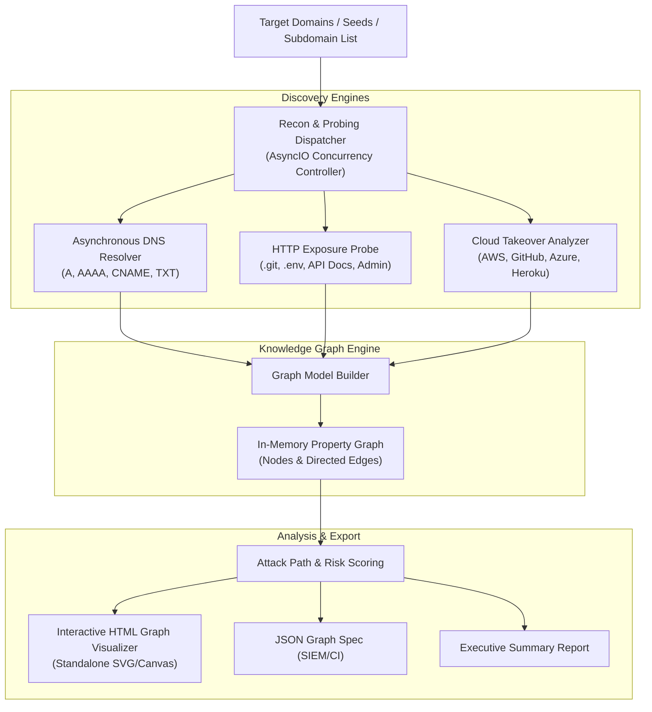
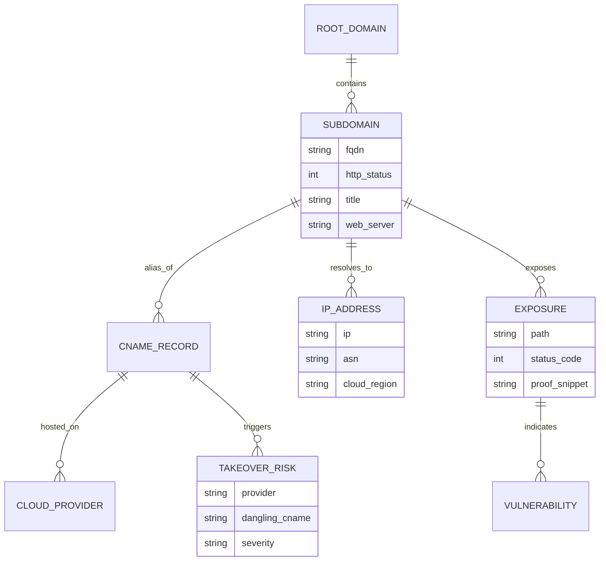

# SpecterGraph System Architecture

## 1. Executive Overview

**SpecterGraph** is an autonomous Attack Surface Management (ASM) and Threat Exposure Knowledge Graph platform. 

It solves the "flat list problem" in security reconnaissance: instead of dumping disconnected text files of subdomains and IP addresses, SpecterGraph maps all discovered infrastructure into a **relational property graph** ($G = (V, E)$), correlating domain names, cloud CNAME aliases, exposed endpoints, and misconfigurations into clear, actionable attack paths.

---

## 2. End-to-End System Architecture

---

## 3. Entity-Relationship Graph Model

---

## 4. Subdomain Takeover Detection Mechanics

When a service is deleted (e.g. an Amazon S3 bucket or GitHub Pages site), DNS records often linger pointing to the cloud provider's shared domain name:
1. `docs.target.com` $\to$ CNAME `target-docs.s3.amazonaws.com`
2. If `target-docs` S3 bucket has been deleted, an attacker can register the bucket `target-docs` in any AWS account and achieve complete domain hijacking.
3. SpecterGraph performs fingerprint pattern matching against HTTP response bodies and DNS NXDOMAIN statuses across 15+ major cloud providers.
